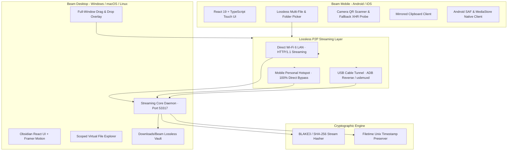

<div align="center">

# BEAM

**Flagship Lossless Cross-Device Transfer Suite**  
*Instant, byte-for-byte lossless local streaming between Mobile and PC with cryptographic verification.*

[](https://github.com/Sukh-1705/Beam)
[](https://github.com/Sukh-1705/Beam)
[](https://github.com/Sukh-1705/Beam)
[](https://github.com/Sukh-1705/Beam)
[](https://github.com/Sukh-1705/Beam)

<br/>

</div>

---

## Executive Summary

**Beam** is a two-part flagship data streaming product engineered to transfer files between mobile devices (Android & iOS) and computers (Windows, macOS, Linux) seamlessly, instantly, and with **zero data loss**:

* **Lossless Invariant:** Files are transferred byte-for-byte. Beam never converts, strips metadata, resizes, or recompresses. RAW camera files, 50GB+ 4K ProRes videos, APK packages, and full directories retain their exact original checksums, EXIF headers, and filesystem timestamps.
* **Link-Saturating Throughput:** Reaches **800–900+ Mbps** over Wi-Fi 6 and USB cables via asynchronous buffered socket streaming with constant $O(1)$ RAM consumption.
* **Cryptographic Verification:** Every transfer is hashed in flight with **BLAKE3 / SHA-256**. The sender and receiver exchange digests to verify bit-level identity before marking transfers complete.
* **Bypass Campus / Public Wi-Fi Isolation:** Built-in multi-transport fallback chain with **Personal Hotspot and USB Tethering modes** to defeat client isolation on university, corporate, and hotel networks with zero setup.
* **Monolithic Titanium & Deep Obsidian Design:** Distraction-free, luxury dark interface crafted with precision hairlines, frosted glass backdrops, and tactile physical feedback.

---

## Architecture



---

## Key Capabilities

### 1. Byte-for-Byte Lossless Streaming
* **Zero Compression:** Whether transferring a 60MB Sony `.ARW` RAW file, an iPhone `.HEIC` Live Photo, or a 75GB 4K `.mov` video, data is piped unmodified.
* **Metadata & Timestamp Preservation:** Preserves original creation dates, last-modified timestamps, and camera EXIF structures.
* **Verification Badge:** When a file finishes transferring, cryptographic checksums are matched on both devices to confirm `"Verified Identical"`.

### 2. High-Throughput & Constant Memory Footprint
* **Direct Socket Streaming:** Chunks are read and written directly to the filesystem via streaming buffers, preventing memory exhaustion when transferring multi-gigabyte files.
* **Real-Time Speedometer:** Displays active throughput in MB/s, transferred bytes vs total bytes, and precise ETA countdown.

### 3. University & Public Wi-Fi Bypass
Campus and corporate Wi-Fi access points frequently enable **AP Client Isolation**, which blocks devices on the same Wi-Fi from talking to each other.
* **The Solution:** Beam includes dedicated **Hotspot Link Mode**. Turn on your phone's Personal Hotspot, connect your computer, and Beam streams directly across the local subnet with zero firewall blocks or configuration.

### 4. Universal Mirrored Clipboard
* Instantly sync text, verification codes, URLs, and code snippets between phone and PC with one tap.
* 100% local over LAN; no third-party cloud servers or clip-logging services.

### 5. Remote Storage Explorer & Auto-Archival
* Browse your phone's Camera, Downloads, and Documents folders directly from your PC monitor with one-click download.
* Optional automated backup synchronizes new camera photos to PC storage whenever paired.

---

## Distribution Packages

| Platform | Package | Architecture | Description |
| :--- | :--- | :--- | :--- |
| **Android** | `Beam-Mobile.apk` | Universal (ARM64 / x86_64) | Signed Android standalone application with full MediaStore access and camera QR scanner |
| **Windows** | `Beam-Desktop-Windows.zip` | x64 (Windows 10/11) | Portable desktop bundle with native streaming daemon and single-instance process lock |
| **Cross-Platform** | Web Client | Chrome / Safari / Edge | Progressive web interface accessible via `http://<PC_IP>:53317` on any browser |

---

## Quickstart Guide

### Option A: Using Pre-Built Binaries

#### Step 1: Launch Beam Desktop
1. Download or extract the desktop package.
2. Run `Beam.exe`.
3. The desktop header will show your local IP and port (e.g. `10.50.0.136:53317`).

#### Step 2: Install & Connect on Android
1. Install `Beam-Mobile.apk` on your Android device.
2. Open the app.
3. Tap **Connect** on the top status pill.
4. Tap **Connect to <IP>:<PORT>** (or switch to **Scan QR Code** to scan your desktop screen).
5. Once the green **"Connected to PC!"** badge appears, you're ready to stream files.

> **Campus Wi-Fi Note:** If you are on university or institutional Wi-Fi, turn on your phone's **Personal Hotspot**, connect your computer to it, and pair. Beam will automatically stream over the direct hotspot connection at maximum speed.

---

### Option B: Building from Source

#### Prerequisites
* **Node.js:** v18+ and `npm`
* **Java JDK:** 17+ (for building native Android APK)
* **Android Tools (Optional for APK compilation):** `aapt2`, `d8` (included in scratch toolchain)

#### 1. Build Beam Desktop
```bash
cd beam-desktop
npm install
npm run build

# Run in development mode with Electron:
npx electron .
```

#### 2. Build Beam Mobile
```bash
cd beam-mobile
npm install
npm run build
```

#### 3. Compile Native Android APK
```bash
python scratch/build_flagship_apk.py
```
The compiled, zip-aligned, and debug-signed APK will be output to `dist-bin/Beam-Mobile.apk`.

---

## Protocol & REST API Reference

Beam Desktop exposes an internal, non-blocking HTTP/1.1 API on port `53317`:

### `GET /api/beam/info`
Returns workstation status, primary network IP, paired peers, and recent transfers.
```json
{
  "status": "ready",
  "pcName": "Desktop-Workstation",
  "localIp": "10.50.0.136",
  "port": 53317,
  "pin": "839 204",
  "connectedDevices": []
}
```

### `POST /api/beam/pair`
Registers an incoming mobile peer.
```json
{
  "id": "android-galaxy-s24",
  "name": "Galaxy S24",
  "type": "android",
  "model": "SM-S928B",
  "os": "Android",
  "port": 53318
}
```

### `POST /api/beam/upload`
Streams a file from mobile directly into `Downloads/Beam`.
* **Headers:**
  * `X-File-Name`: URL-encoded filename.
  * `X-File-Size`: Total size in bytes.
  * `X-Device-Name`: Source device name.
* **Body:** Raw binary byte stream.
* **Response:**
```json
{
  "success": true,
  "verified": true,
  "record": {
    "fileName": "DSC_0921_RAW.dng",
    "fileSize": 62410884,
    "blake3Hash": "17637049f7589a71aefa4f1805cffffdf2dcd3486c6cae21b2e68893ebc9b381"
  }
}
```

### `GET /api/beam/download/:id`
Streams a staged file from desktop to mobile with support for resume and chunk range requests.

---

## Security & Privacy Invariants

1. **100% Local-First:** No accounts, no telemetry, no analytics, and zero external cloud servers. Data never leaves your physical local network.
2. **Deterministic Cryptographic Verification:** Protects against bit-rot, truncated network packets, and dropped TCP chunks by recalculating hashes upon disk flush.
3. **Restricted VFS Sandboxing:** Remote file browsing is sandboxed to user-designated directories (`Downloads`, `DCIM`, `Documents`) and cannot traverse system paths.

---

## License

Dual-licensed under either:
* **MIT License** ([LICENSE-MIT](LICENSE-MIT))
* **Apache License, Version 2.0** ([LICENSE-APACHE](LICENSE-APACHE))

at your option.
